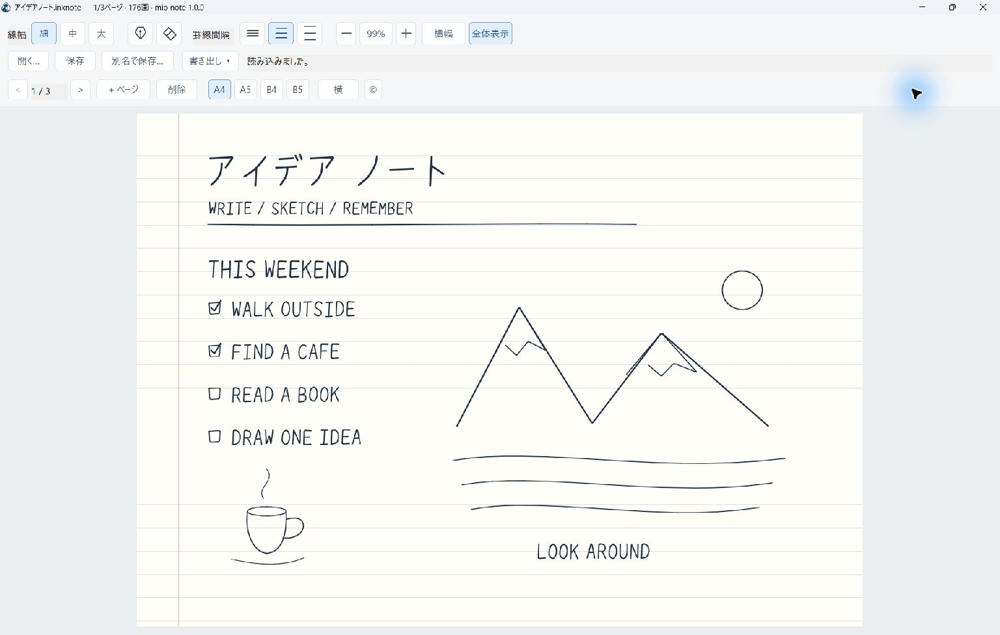

# MioNote — 水筆（みお）


A minimal handwriting notebook for Windows 11 (ARM64 and x64), built with Rust and native Windows Ink.

「水筆」と書いて「みお」。mio noteはWindows 11のARM64・x64向けの軽量な手書きメモアプリです。
起動の速さとペンの追従を重視し、
Win32のウィンドウにWindows Inkの描画面を重ねています。UIや描画にWebView・.NETは使いません。

現在のバージョンは **1.0.0** です。ページの追加・削除、拡大縮小・スクロール、A4・A5・JIS B4・JIS B5の複数ページとPDF・PNG・SVG出力に対応しています。



画面内の文字と図は、掲載用に作成した筆跡サンプルです。

公開前の入力検証・保存処理・依存関係の確認結果は[セキュリティレビュー](docs/security-review-20261027.md)にまとめています。
Store／ポータブルの違い、本人性・プライバシー・提出前の確認は[配布手順](docs/store-release.md)と[追加レビュー](docs/store-security-review-20261027.md)を参照してください。
0.5.0まではSurface Pro（Microsoft SQ2）で通常の筆記動作を確認しています。
Windows ARM64で自動テストと、出力の実寸・描画・PNGの解像度を確認しています。
Undoは未実装です。
ペンを非常に速く動かした際に線の一部が欠ける現象は、引き続き確認が必要です。

## 機能

- Windows Inkによるペン入力、筆圧、ストローク単位の消しゴム。
- 線幅3段階、筆圧のオン／オフ、罫線間隔3段階。
- 線幅・筆圧・罫線間隔の設定を次回起動時に復元。
- `.inknote`形式で保存・読み込み・別名保存。読み込み後の追記や消去に対応。
- 固定用紙4種類、縦横の切り替え、ページの追加・削除と前後移動。
- ページごとの用紙サイズ・向き・罫線間隔を保持し、全ページを実寸のPDFへ出力。
- 現在のページをPNG（300dpi）・SVGへ出力。全ページをページ順の画像ZIPにも出力。
- 未保存の変更を確認してから、終了や別のノートの読み込みを実行。
- 初期表示は横幅に合わせ、縦にスクロールして筆記。横幅・全体表示と25〜400%の拡大縮小。
- 拡大時の縦横スクロール。保存座標は表示倍率から独立した96 DPIのDIPへ統一。

## 実行

動作対象は **Windows 11 / ARM64・x64** です。筆圧入力には対応するペンと端末が必要です。
マウスの左ドラッグでも書けます。指による描画は無効です。

配布用の `MioNote-1.0.0-portable-arm64.zip または MioNote-1.0.0-portable-x64.zip` を「すべて展開」し、`MioNote.exe` を実行します。
Rust・Visual Studio・.NET・WebView2のインストールは不要です。
VC++ランタイムは静的リンクしています。実行ファイルにコード署名は付けていません。

このソース一式にはEXEを含めていません。ソースから実行する場合は、以下の手順でビルドしてください。

## ビルド

必要な開発環境：

- Windows 11とPowerShell 7。
- Rustup。使用するRustは `rust-toolchain.toml` の **1.98.1** に固定しています。
- Visual StudioまたはBuild ToolsのC++開発環境、対象CPU向けの**ARM64またはx64 MSVC**、Windows SDK（`rc.exe`を含む）。

確認済みの構成は、Windows ARM64上のMSVC **14.44.35207**、Windows SDK **10.0.26100.0** です。
Visual StudioのDeveloper PowerShellなど、ビルド対象のCPUに対応したMSVC／Windows SDK環境で実行してください。
ARM64端末ではまずARM64版、Intel／AMD端末ではまずx64版をビルドできます。
Rustupは初回に指定されたツールチェーン、ターゲット、rustfmt、Clippyを取得します。
依存crateの取得を含め、初回ビルドにはネット接続が必要です。

```powershell
.\build.ps1
.\build.ps1 -Run
.\build.ps1 -Architecture x64
.\build.ps1 -Store
```

ビルド先は `target/aarch64-pc-windows-msvc/release/mio-note.exe` です。
ビルド後は `run.cmd` からも起動できます。標準のCargoコマンドも使用できます。

```powershell
cargo build --locked --release --target aarch64-pc-windows-msvc
```

`.cargo/config.toml` でARM64・x64向けのVC++ランタイム静的リンクを設定しています。
`build.rs` がWindows SDKの `rc.exe` を使い、アイコンと製品名・バージョン情報をEXEへ埋め込みます。
`rc.exe` がPATHにない場合は、環境変数 `RC` にその実行ファイルのパスを指定できます。
RustやMSVC本体、ダウンロード済みcrateはソースZIPに同梱していません。

## 操作

| 操作 | ボタン・ショートカット |
| --- | --- |
| 保存 | 「保存」 / `Ctrl+S`。初回は保存先を選択 |
| 読み込み | 「開く…」 / `Ctrl+O` |
| 別名で保存 | 「別名で保存…」 / `Ctrl+Shift+S` |
| 書き出し | 「書き出し ▾」でPDF / PNG / SVGと範囲を選択 |
| PDF出力 | `Ctrl+E`。全ページを順番に出力 |
| ページ追加・移動 | 「+ ページ」で末尾へ追加。「<」「>」で前後移動 |
| ページ削除 | 「削除」で現在のページを確認後に削除。最後の1ページは残す |
| 用紙・向き | A4 / A5 / B4 / B5と「縦」「横」の切り替え |
| 拡大・縮小 | 「＋」「−」 / `Ctrl+＋`・`Ctrl+−` / `Ctrl+ホイール` |
| 横幅に合わせる | 「横幅」 / `Ctrl+1`。ウィンドウの幅に追従 |
| 全体を表示 | 「全体表示」 / `Ctrl+0`。1ページ全体を表示 |
| 100%に戻す | 現在の倍率のボタンをクリック / `Ctrl+2` |
| スクロール | ホイール・スクロールバー。横方向は`Shift+ホイール`や横ホイール |
| ページ内の移動 | `PageUp`・`PageDown`、`Home`で上端・`End`で下端 |
| 消しゴム切り替え | 消しゴムアイコン / `E` |
| ペンに戻る | 消しゴムをオフ / `P` |

線幅は「細・中・太」、罫線間隔は横線アイコンで「狭・標準・広」を選びます。
ペン先のアイコンで筆圧を切り替えます。筆圧・消しゴムの青い表示はオンです。
線幅と筆圧の変更は、これから書く線に反映されます。既存の筆跡は変わりません。
対応するペンの消しゴム側も使用できます。各ボタンにポインターを重ねると説明が表示されます。

初期設定は「細・筆圧オフ・罫線間隔は標準」です。
設定は変更時にバックグラウンドで保存します。ポータブル版はEXEの隣の `data/settings.ini`、Store版はアプリ専用のLocalStateです。
連続した変更は最新の設定にまとめ、終了時は最後の保存が完了してから閉じます。
ポータブル版の設定を引き継ぐ場合はdataフォルダーを一緒に移動します。
マーカーのない開発用ビルドだけは、従来の `%LOCALAPPDATA%\InkNote` を継続します。
消しゴムモードは保存せず、起動時はペンになります。

## ノートファイル

筆跡の保存は手動です。タイトルの `*` は未保存の変更を表します。
`.inknote` は `document.json` と、ページごとの `pages/0.isf` などを持つZIPです。
用紙サイズ・向き・罫線間隔と、全ページの筆跡・筆圧・色・線幅を保存します。
初期用紙はA4縦です。追加ページは現在のページの用紙・向き・罫線間隔を引き継ぎます。
削除後は次のページを表示し、末尾を削除した場合は前のページを表示します。
削除は取り消せません。変更は未保存になり、Ctrl+Sで保存するとファイルにも反映します。
起動時は横幅に合わせて表示します。「全体表示」で用紙を一度に見渡せます。
表示倍率・スクロール位置はノートの実寸や保存内容へ反映しません。起動のたびに横幅表示で始めます。
小さい用紙や向きへの変更では、筆跡が収まるように比率を保って縮小します。大きくする場合は拡大しません。
読み込みに失敗した場合は現在の筆跡を残します。保存は同じフォルダーの一時ファイルを完成させてから置き換えます。

形式バージョンは2です。0.7.0のノートも使えます。0.6.0以前の単一ページ形式には対応していません。
ノートをEXEにドラッグするか、`MioNote.exe <ノートのパス>` でも開けます。
Windowsへの拡張子の関連付けは行いません。詳細は [ファイル形式](docs/inknote-format.md) を参照してください。

## ソース構成

| ファイル | 役割 |
| --- | --- |
| `src/main.rs` | 起動、WinRT初期化、診断ログ |
| `src/ui.rs` | Win32ウィンドウ、罫線、入力、ツールバー配置 |
| `src/ui/about.rs` | 元の絵を表示するバージョン情報・コピーライト |
| `src/ui/document.rs` | 保存・読み込み、変更状態、保存確認 |
| `src/ui/view.rs` | 表示切り替え、ホイール・キー・ネイティブスクロールバー |
| `src/toolbar.rs` | GDIで描くボタンとアイコン |
| `src/ink.rs` | Windows Inkホスト、専用スレッド、DirectComposition |
| `src/ink_io.rs` | ワーカースレッドでのISF変換、DPI補正 |
| `src/note.rs` | `.inknote`のZIP・JSON処理 |
| `src/storage.rs` | パス検証、排他的な一時ファイル、出力サイズ制限 |
| `src/validation.rs` | 筆跡の有限数・座標・点数・複雑度の検証 |
| `src/paper.rs` | 固定用紙の実寸 |
| `src/view.rs` | 表示倍率・スクロール範囲とズーム中心の計算 |
| `src/pdf.rs` | ワーカーで実行するベクターPDF出力 |
| `src/drawing.rs` | PDF・PNG・SVGで共通の筆跡・罫線の描画 |
| `src/export.rs` | 出力形式・単一ページ・全ページZIP |
| `src/png.rs` | PNG出力時だけ読み込むWindows画像処理 |
| `src/svg.rs` | 実寸とベクターのSVG出力 |
| `src/file_dialog.rs` | Windows標準のファイル選択ダイアログ |
| `src/settings.rs` | 線幅・筆圧・罫線間隔と設定ファイル |
| `src/settings/writer.rs` | 初回の設定変更時に起動する保存ワーカー |
| `build.rs` | Windowsアイコンと製品情報の埋め込み |

Windows Inkが入力中と確定後の線を描画します。Rustで筆点を逐次再描画する構成ではありません。
InkPresenterとライブのストロークコンテナーはInkホストの専用スレッドで操作し、
ファイル処理は複製した筆跡を使ってワーカースレッドで行います。
開発時の注意と確認手順は [CONTRIBUTING.md](CONTRIBUTING.md) にまとめています。

## 配布物の作成

```powershell
.\package.ps1 -Architecture arm64 # ポータブル版ARM64
.\package.ps1 -Architecture x64   # ポータブル版x64
.\package-store.ps1               # Store用ARM64+x64のMSIX/bundle
.\package-source.ps1  # ソースZIPとSHA-256
.\package-source.ps1 -GitHub  # GitHub公開用のフォルダーとZIP
```

生成物は `dist/` に置きます。配布ビルドは `target/portable-arm64`・`target/portable-x64` と `target/store-arm64`・`target/store-x64` に分離します。
ソースZIPは明示したファイルだけを集め、`.cargo/config.toml` や `.gitignore` も含めます。
`target/`、既存の `dist/`、手書きノート、診断ログ、ユーザー設定は収録しません。
ソースZIP内の `SOURCE-MANIFEST.sha256` で、収録ファイルのハッシュを確認できます。

## GitHubでの公開

`.\package-source.ps1 -GitHub` で `dist/MioNote-1.0.0-github/` と同名のZIPを作成します。
このフォルダーの中身をリポジトリのルートへ置いてください。ソース、ビルド用スクリプト、
アイコン、合成テストデータ、MITライセンス、依存ライブラリのライセンスと検証記録を含みます。
公開用フォルダーに既存ファイルがある場合は、上書きを避けて処理を中止します。
手順と公開対象は[GitHub公開手順](docs/github-publish.md)にまとめています。


## アイコン

「水筆（みお）」の水滴と、筆を走らせる着物の少女を、深い藍色と生成りの影絵で描いています。
1.0.0では小さな表示でも見やすいように、髪飾り・着物の細線・波を省き、人物を大きくしました。
新しい原画は `assets/branding/mio-note-v2.png`、Windows用のICOは `assets/mio-note.ico` です。
ICOには16 / 20 / 24 / 32 / 40 / 48 / 64 / 128 / 256ピクセルの画像を含めています。
原画からICOとREADME用PNGを再作成する場合は `.\make-icons.ps1` を実行してください。
原画は組み込みの画像生成ツールで作成しました。[生成プロンプト](assets/branding/mio-note-v2.prompt.txt) も収録しています。
Store用の画像は `.\make-store-assets.ps1` で再作成できます。
元の絵は `assets/branding/mio-note-v1.png` に保持しています。ツールバーの「©」またはF1で開く
「バージョン情報・コピーライト」に大きく表示します。画像の読み込みはその画面を開いたときだけ行います。

## 診断

通常起動ではログファイルを作成・更新せず、診断用の文字列も生成しません。
診断するときだけ、PowerShellで環境変数を指定して起動します。

```powershell
$env:MIONOTE_DIAGNOSTICS = '1'
& .\MioNote.exe
```

診断時は、設定と同じデータフォルダーの `mio-note.log` に
初期化・設定変更・ストローク数などを記録します。ストローク数のログはUIスレッドが記録します。
ログは診断起動ごとに更新し、筆跡の座標は記録しません。
通常起動へ戻すには環境変数を削除するか、新しいPowerShellを開いて起動してください。
初期化時間と、ペン入力から画面表示までの遅延は別の指標です。

## 軽量化

Inkの初期化とツールバー作成を並行して進め、同じサイズへの重複した更新を省きます。
書き終わるたびに筆跡コンテナー全体を取得せず、追加・消去された画数だけで件数を更新します。
設定のディスク書き込みと同期は専用ワーカーが担当します。

0.6.0時点の測定条件・起動時間・メモリ使用量は [性能測定](docs/performance.md) に保存しています。
0.7.0のページ制・PDF出力の確認内容は [ページとPDF](docs/pages-and-pdf.md) を参照してください。
実ペンの追従遅延は別途実機での確認が必要です。

## 書き出し

「書き出し ▾」から次の形式を選びます。どの形式も白背景と罫線を含みます。

| 形式 | 範囲と内容 |
| --- | --- |
| PDF | 全ページを実寸の1ファイルへ。Ctrl+Eでも出力 |
| PNG | 現在のページ、300dpi、アンチエイリアスあり |
| SVG | 現在のページ、実寸mmとベクター |
| PNG / SVGのZIP | 全ページをpage-0001.png / page-0001.svgなどの連番で格納。空白ページも含む |

PNGとSVGの確認内容は [出力形式](docs/export-formats.md) を参照してください。

PDFは各用紙の実寸で、筆跡と罫線をベクターとして出力します。空白ページも含めて全ページが対象です。
プリンタードライバーや外部PDFライブラリは不要です。PDFには白い背景を使い、画面の周囲の余白は含めません。
どの出力形式でも筆圧ありの線は幅へ変換して近似するため、補間や端部の形状がWindows Inkの画面と異なる場合があります。
元の筆点・筆圧と編集情報は`.inknote`に保持します。PDFからの再編集・取り込みは行いません。

共有・文書への貼り付けにはPNG、図版の拡大や再利用にはSVGを使えます。
PNGのWindows画像処理は出力するときだけ読み込み、起動時や通常の筆記では初期化しません。

## ライセンス

本体のソースコードとアイコンは [MIT License](LICENSE) です。
依存ライブラリはそれぞれのライセンスに従います。表記とライセンス本文は
[distribution/THIRD-PARTY-NOTICES.txt](distribution/THIRD-PARTY-NOTICES.txt) と
`distribution/licenses/` に同梱しています。

変更履歴は [CHANGELOG.md](CHANGELOG.md) を参照してください。
